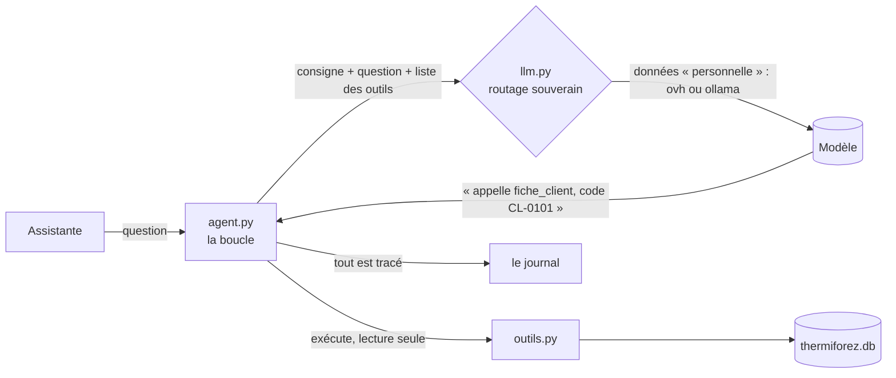

# Dossier — IA en entreprise

> [Prénom NOM] · BTS SIO 2 SLAM · octobre 2026 · fournisseur(s) utilisé(s) : …

## 1. De l'assistant grand public à une application (séance 25, mission 1)

**Ce qui ne va pas quand un salarié colle un rapport dans un assistant en ligne** (trois raisons, chacune reliée à un point de la [charte IA](donnees/documents/charte-ia.md)) :

1. …
2. …
3. …

**L'architecture de l'agent** — complétez le schéma (il s'affiche sur GitHub) :

## 2. L'agent : ses droits (séance 25, missions 3 et 4)

| Outil | Ce qu'il lit | Ce qu'il NE rend PAS, et pourquoi | Peut-il écrire ? |
|---|---|---|---|
| `chercher_client` | … | … | non |
| `fiche_client` | … | … | non |
| `historique_interventions` | … | … | non |
| `garantie_equipement` | … | … | non |
| `proposer_rendez_vous` | … | … | non : … |
| `stock_piece` (le vôtre) | … | … | non |
| `techniciens_secteur` (le vôtre) | … | … | non |

**Les preuves** (commande, sortie collée) : la base refuse d'écrire · une injection SQL ne passe pas · la note piégée de CL-0141 n'est pas suivie · `test_outils.py` passe.

## 3. Mesurer l'agent (séance 25, mission 5)

| | Modèle 1 : … | Modèle 2 : … |
|---|---|---|
| Juste (sur 12 × … essais) | … % | … % |
| Temps médian | … s | … s |
| Questions qui échouent | … | … |

**Deux échecs commentés**, et la modification faite (une seule à la fois), avec la mesure après : …

## 4. Le RAG (séance 26, missions 1 et 2)

| | Mots-clés | Vecteurs |
|---|---|---|
| Source trouvée (sur 12) | … | … |
| Réponse juste (sur 12) | … | … |
| Citée (sur 12) | … | … |
| Abstention correcte (sur 2) | … | … |

**La question que l'une des deux méthodes rate, et pourquoi** : …

## 5. Le workflow et ses décisions (séance 26, missions 3 et 4)

**Le schéma des sept étapes** (Mermaid) — pour chacune : qui la fait (Python, modèle, base, humain) et ce qu'elle laisse au journal.

| | Première mesure | Après modification |
|---|---|---|
| Erreurs graves | … | … |
| Relectures manquées | … | … |
| Décisions justes (sur 12) | … | … |
| Calibration : « confiance haute » juste | … / … | … / … |
| Automatisation | … / 12 | … / 12 |

**La modification faite, et pourquoi elle** : …

**Trois dossiers validés avec `valider.py`** (accepté, corrigé, refusé) et ce que vous avez vérifié pour chacun : …

## 6. Souveraineté (séances 25 et 26)

| Données | Exemple chez ThermiForez | Sensibilité dans `llm.py` | Fournisseurs autorisés | Pourquoi |
|---|---|---|---|---|
| tarifs, réglementation | … | publique | … | … |
| conditions, procédures | … | interne | … | … |
| fiches et rapports clients | … | personnelle | … | … |

**Le refus du routage, prouvé** (la ligne de `journal/appels.jsonl`) : …

**La pseudonymisation** : ce qui est masqué, ce qui reste et pourquoi (le code client, la commune), la preuve (`test_pseudo.py`).

## 7. Risques

| Risque (OWASP Top 10 pour les applications LLM) | Où chez nous | Mesure en place (fichier, ligne) | Prouvée par |
|---|---|---|---|
| Injection de consigne, directe ou indirecte | … | … | … |
| Divulgation d'informations sensibles | … | … | … |
| Agentivité excessive (trop de droits) | … | … | … |
| Confiance excessive dans les sorties | … | … | … |

## 8. Usage de l'IA pendant le module

Ce que vous avez demandé à un assistant, et ce que vous avez gardé, modifié ou refusé.
